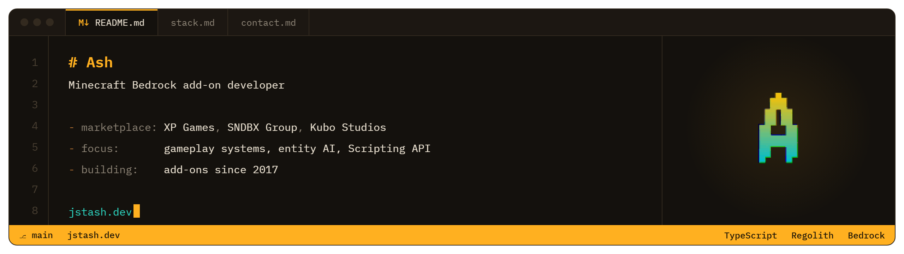
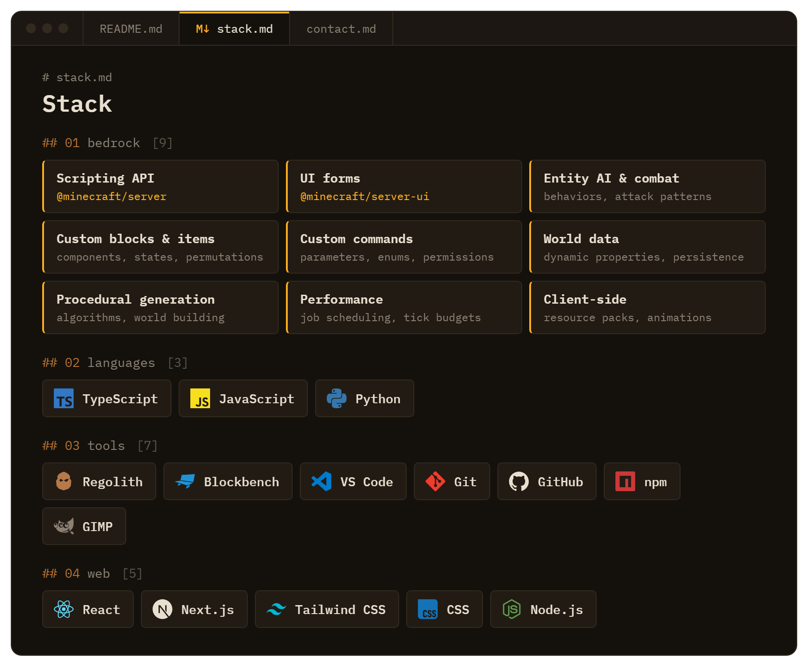

Hello there, I make Add-Ons for Minecraft Bedrock, mostly gameplay systems built on Scripting API with TS/JS. Currently working at [XP Games](https://x.com/XPGAMESApS), check out my portfolio at [jstash.dev](https://jstash.dev).

## Stack

## Projects

| Add-on | What it does |
| --- | --- |
| **[item-editor](https://github.com/Justash01/item-editor)** | Edit existing items in game (names, lore, enchantments, durability, books, signs) from forms or custom commands |
| [maze-generator](https://github.com/Justash01/maze-generator) | Simple configurable mazes, generated across ticks with `system.runJob` for further optimization |
| [block-patterns](https://github.com/Justash01/block-patterns) | Detects 3D block patterns in the world, checked against every rotation and reflection |
| [dynamic-lights](https://github.com/Justash01/dynamic-lights) | Held torches light up their surroundings in real time |
| [inventory-saver](https://github.com/Justash01/inventory-saver) | Named, per-player inventory snapshots, equipment included |
| [some-commands](https://github.com/Justash01/some-commands) | `!`-prefixed chat commands: teleport requests, AFK detection, reminders, and more |

## Contact

[contact@jstash.dev](mailto:contact@jstash.dev) · Discord `jstash` · [X](https://x.com/jstAsh01)
